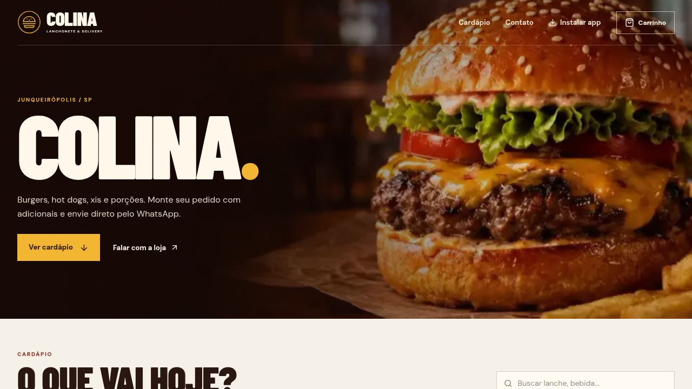

# Colina Lanches

Cardápio digital e montagem de pedido para uma lanchonete de bairro. O cliente escolhe itens, adicionais e observações, monta a sacola e revisa o pedido antes de enviar.

> **Demonstração pública.** Telefone, WhatsApp, endereço, Instagram e preços são fictícios. Nenhum pedido é enviado.

**Demo:** [colina-lanches.vercel.app](https://colina-lanches.vercel.app)  
**Stack:** React 19 · TypeScript · Vite 7 · Tailwind CSS 4 · Framer Motion · PWA



## Recursos

- Cardápio com 10 categorias, busca e destaques.
- Modal de produto com adicionais, quantidade e observação.
- Sacola persistida em `localStorage`, edição de itens e cálculo de subtotal.
- Checkout com entrega/retirada, pagamento e troco.
- Mensagem de pedido pré-montada (bloqueada nesta demonstração).
- PWA instalável, com manifest, ícones e service worker.
- Layout responsivo com barra de sacola no mobile.
- Aviso global que intercepta contatos fictícios.

## Rodando

```bash
npm install
npm run dev
npm run typecheck
npm test
npm run build
npm run preview
```

## Estrutura

```
src/
  components/     # CartPanel, ProductModal, OrderModal, DemoNotice
  data/           # menu.json e imagens
  hooks/usePwa.ts # instalação e modo offline
  utils/cart.ts   # regras de carrinho, preços e mensagem
  App.tsx         # página e estados da sacola
public/
  icons/          # ícones PWA (192, 512 e maskable)
  sw.js           # cache offline
```

## Dados de demonstração

Em `src/data/menu.json`:

| Campo | Valor |
| --- | --- |
| WhatsApp | `5518000000000` |
| Endereço | Rua das Acácias, 120 — Centro, Junqueirópolis/SP |
| Instagram | `@exemplo.demo` |

O aviso em `src/components/DemoNotice.tsx` bloqueia links de contato e o envio do pedido. Para uso real, troque os dados, remova o `DemoNotice` e conecte o checkout ao WhatsApp da loja.

## Qualidade

- `npm run typecheck` e `npm run build` com verificação de tipos.
- `npm test` — 5 testes de carrinho, subtotal, agrupamento e mensagem.
- Verificação manual: busca, filtros, adicionais, sacola, checkout, PWA e mobile.

## Deploy

Vercel, framework **Vite**, build `npm run build`, output `dist`. O `vercel.json` não é necessário; todas as rotas são âncoras.

## Fluxo

Gitflow + Gitmoji. Veja [CONTRIBUTING.md](CONTRIBUTING.md) e [AGENTS.md](AGENTS.md).

## Licença

Código MIT; marca, fotos e textos comerciais não estão incluídos. Veja [LICENSE](LICENSE).
